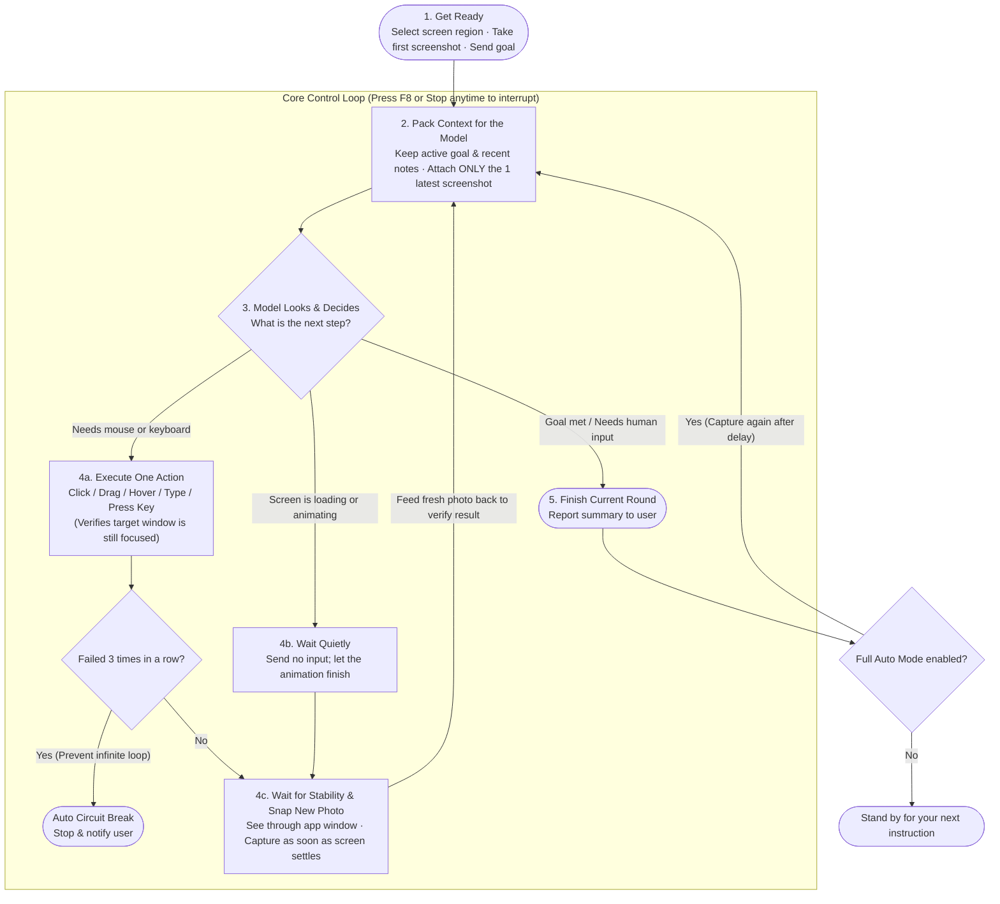

<div align="center">

# VLM_Screenshot_Action

[](./LICENSE)
[](https://www.microsoft.com/windows)
[](https://tauri.app)

[简体中文](./README.md) | **English**

### Seeing is acting.

A Windows reference implementation of a screenshot-driven visual control loop.<br/>
No memory reading. No process injection. No game-specific hooks.<br/>
Just screen pixels, model reasoning, and bounded native input working in a closed loop.

[Releases](https://github.com/s11IM/VLM_Screenshot_Action/releases) · [Architecture](./docs/architecture.md) · [Validation](./docs/validation.md) · [Contributing](./CONTRIBUTING.md) · [Security Policy](./SECURITY.md)

</div>

---

## Rethinking the Visual Control Loop

Connecting a vision-language model to desktop input is straightforward. Keeping it grounded, accurate, and interruptible across dozens of consecutive steps is not.

Typical automation scripts break down in four places: accumulating screenshots confuse the model with stale states; fixed sleep timers either waste time or capture mid-animation; the controller window obscures the target area; and unexpected focus shifts leave the keyboard typing into the wrong application.

**VLM_Screenshot_Action** reduces the control loop to four disciplined stages: **Observe — Decide — Act — Verify**. Dispatched input is never treated as proof of success; every action is verified against the next real screenshot.

---

## Core Design

### 1. Grounded in the Present, Aware of the Past
**Single-frame anchoring with projected context.**  
Full conversation and screenshot histories are persisted locally in IndexedDB with image payloads stored separately from message records. When building a model request, however, the controller projects only the most recent cycles (default: `3`), restores the `[ACTIVE_TASK]` and `[LAST_ROUND_SUMMARY]`, and strips earlier images—**retaining only the single latest capture as `CURRENT_FRAME`**.
* Eliminates multi-image confusion and stale coordinate grounding
* Marks user-uploaded images as `REFERENCE_IMAGE` so they never become actionable frames
* Keeps token usage and bandwidth predictable across long sessions

### 2. Sensitive to Change, Patient for Stability
**Adaptive screen-settling detection.**  
Instead of relying on rigid sleep timers after an action, the built-in `adaptive-window-v4` sampler monitors a `320px` grayscale grid across global mean, peak block mean, and active-pixel fraction:
* **Early Wake**: As soon as a meaningful screen change occurs and settles across a `1.8s` rolling window, the wait finishes early and returns a fresh screenshot.
* **Conserved Time Budget**: If the model calls `wait` immediately after an early wake, the timer resumes only the unspent remainder rather than extending the round indefinitely.
* **Capture Exclusion**: On Windows 10 2004+, the app window is excluded from probing via `WDA_EXCLUDEFROMCAPTURE`. Even when the controller overlaps the target region, it neither blocks the detector's view nor triggers false motion; for the final capture, the window briefly hides to guarantee a clean frame.

### 3. Intuitive Coordinates, Native Feel
**0–1000 normalized space and physical input.**  
The model never calculates raw screen resolutions. Every spatial tool uses integer coordinates in `0..1000` relative to the selected region, mapped to physical pixels by the Rust core with Per-Monitor DPI V2 awareness and Windows `VIRTUALDESK` support for secondary monitors and negative origins.
* **Visual Feedback Annotations**: Subsequent screenshots annotate the previous click or drag path with a crosshair or arrow, helping the model calibrate placement while the prompt contract strictly separates instruction markers from actual target response.
* **Realistic Timing & Drift Correction**: Clicks hold for `60ms`; drags hover, pick up, move smoothly over `500ms`, and dwell before release. Pointer coordinates are read back before pressing—allowing a single local reposition if drift exceeds `2px` without ever replaying already dispatched clicks.
* **Upstream Protocol Adapter**: Unexpected native `computer` tool calls are safely adapted from frame-pixel coordinates into `0..1000` primitives, while unsupported or unsafe actions are rejected.

### 4. Clear Boundaries, Instant Interruption
**Four layers of execution guardrails.**  
Automation is only useful when you can let go—and stop at any moment:
* **Spatial Containment**: Mouse actions are strictly bounded to the user-selected rectangle within a single monitor.
* **Frame Token Gate**: Keyboard actions must present the single-use `frameId` issued by the latest capture, matching the region, a `5`-minute freshness window, and the exact foreground window handle (`HWND`). If focus changes mid-typing, execution aborts immediately and releases pressed keys in reverse order.
* **F8 Emergency Stop**: During keyboard hold/typing and settling waits, the native layer polls the physical `F8` key state; the UI stop button sets an atomic cancellation flag (`AtomicBool`) to interrupt pending HTTP requests or input sequences.
* **3-Strike Circuit Breaker**: A single failed step triggers a fresh screenshot for self-recovery; `3` consecutive unexecutable steps end the round automatically to prevent runaway loops.

### 5. Single-Round Precision or Full Autonomy
**Two distinct observation rhythms.**  
* **Tool-Result Capture**: After `click`, `drag`, `hover`, `keyboard_type`, `keyboard_press`, or `wait`, the system automatically observes the resulting frame and continues the round until the model calls `end_round` or replies with plain text.
* **Full Auto Mode**: Once a formal reply ends a round, an optional completion-triggered timer (default: `15s`) captures a new frame and starts the next round—paired with a compact **Mini Mode** that stays out of the way.

---

## Control Loop at a Glance

In plain terms: **take one action, wait for the screen to settle, snap a fresh photo to verify what actually happened, and only then decide the next move.**



### Built-in Action Primitives

| Primitive | Purpose | Coordinates / Constraints |
| :--- | :--- | :--- |
| `click` | Left single or double click | `x, y ∈ [0, 1000]`, `clicks ∈ {1, 2}` |
| `drag` | Left-button drag from start to end | `fromX, fromY, toX, toY ∈ [0, 1000]` |
| `hover` | Move cursor without clicking | `x, y ∈ [0, 1000]` |
| `keyboard_type` | Type literal Unicode text (including CJK) | Requires valid `frameId` & matching foreground window; no clipboard |
| `keyboard_press` | Press and hold 1–8 keys or chords | e.g., `CTRL`, `ENTER`, `WASD`; `F8` is reserved for emergency stop |
| `wait` | No input; wait for screen change & stability | Duration is governed by the adaptive sampler or remaining budget |
| `end_round` | Conclude the current run with a summary | Used when the goal is met, user input is needed, or no action is required |

---

## Getting Started

### Ready-to-Run (Windows 10 / 11 x64)

1. **Get the App**: Download `VLM_Screenshot_Action-Portable-x64.zip` (extract and run `start.cmd`) or `VLM_Screenshot_Action-Setup-x64.exe` from [GitHub Releases](https://github.com/s11IM/VLM_Screenshot_Action/releases) (from a source checkout, you can also double-click `clickstart.cmd` to build on demand and launch).
2. **Connect a Model**: Open **Settings** in the top-right corner and configure an OpenAI-compatible `/chat/completions` endpoint, API key, and a vision + tool-capable model name.
3. **Select & Run**: Click **Select Region** to frame the target window, take an initial **Manual Screenshot**, enter your goal, and press **Send**.

### Build & Validate from Source

Requirements: Windows 10/11 x64, Node.js `^24.12.0`, Rust stable (MSVC) toolchain, Visual Studio 2022 C++ Build Tools, and WebView2 Runtime.

```powershell
# Install dependencies
npm ci

# Run TypeScript checks, frontend unit tests, and Rust formatting checks
npm run check
npm run fmt:rust:check

# Run unit tests for both desktop-core and src-tauri
npm run test:rust

# Start desktop development mode
npm run tauri -- dev

# Build clean public release artifacts (refuses personal settings and history)
npm run package:public
```

---

## Boundaries & Non-Goals

To keep the reference implementation focused and auditable, several boundaries are deliberate:

* **Not a sandbox or unattended bot**: Screen contents may contain prompt injections and models can misjudge states. Supervise real input on a non-sensitive desktop and test account.
* **No bundled weights or memory readers**: Inference is delegated to your configured external API; the application observes pixels only.
* **No global cost or step cap**: Individual HTTP requests have timeouts and a single optional retry, but a round continues until completion or interruption.
* **Windows-only**: Relies on Win32 input dispatch, Per-Monitor DPI V2, and display affinity APIs. macOS, Linux, and mobile targets are out of scope.

For deeper technical contracts, see [Architecture](./docs/architecture.md), [Validation](./docs/validation.md), [Contributing](./CONTRIBUTING.md), and [Security Policy](./SECURITY.md).

---

## License

Released under the [MIT License](./LICENSE).
