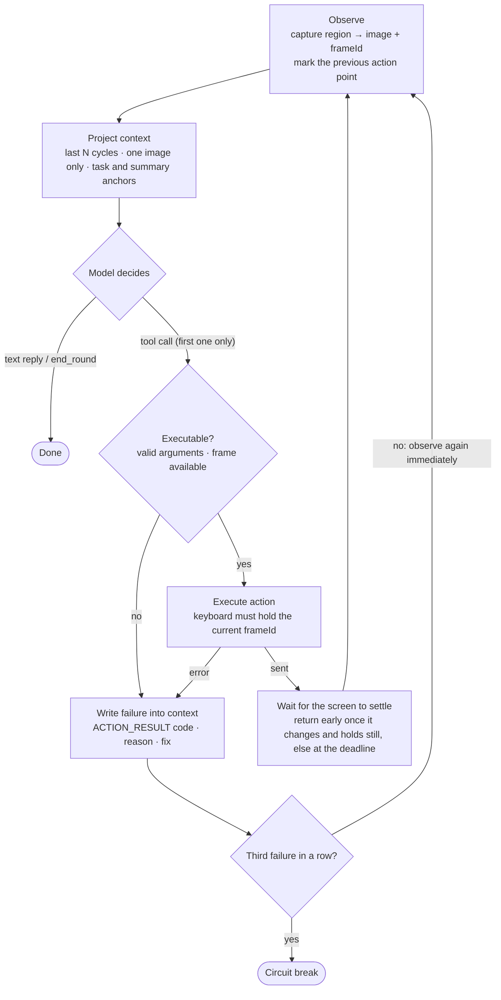

# VLM_Screenshot_Action

[](LICENSE)
[](https://www.microsoft.com/windows)
[](https://tauri.app)
[](https://github.com/s11IM/VLM_Screenshot_Action/actions/workflows/ci.yml)

[中文](README.md) | **English**

A reference implementation of a closed control loop that lets a vision-language model operate desktop programs using nothing but screenshots, mouse, and keyboard.

The repository contains a runnable Windows desktop app (Tauri + React + Rust), but the app is only a demo. What is worth sharing is the design of the loop itself: what the model sees, how an action lands, how its effect is confirmed, and when to stop. None of it depends on Tauri or Windows. The pure-logic parts can be dropped into your own agent; the platform side only needs four interfaces.

---

## The Core Loop



The loop has exactly three exits: the model gives a final reply (**done**), three consecutive actions fail to execute (**circuit break**), or the user stops it at any stage (**cancel**). Beyond that there is no total step limit. This is a deliberate tradeoff; see [Limitations](#limitations).

Terms used below:

| Term | Meaning |
|------|---------|
| round | One user send; may contain many model requests |
| cycle | One screenshot plus the analysis and action results based on it; context is trimmed by cycle |
| `frameId` | A token the native layer issues for each screenshot; keyboard actions must present it |
| `operationId` | The cancellation handle for one run |

---

## Ten Reusable Design Decisions

Each one follows "problem → approach → cost", followed by the code location.

### See: what the model gets

#### 1. Context is a projection, not the history

**Problem**: screenshots are token-expensive. Sending every image makes cost and context grow linearly with steps, and old frames mislead targeting.

**Approach**: the full history stays local; each request builds a small view on the spot:

- Only the last N cycles are selected (`contextCycles`, default 3)
- The whole request keeps only the last image. Earlier images are removed and their labels become `[IMAGE frame=OMITTED]`; the kept image is labeled `CURRENT_FRAME`, and the prompt requires targeting from it alone
- Key information that scrolled out is restored as text anchors: the latest user task → `[ACTIVE_TASK]`, and the latest final reply after that task → `[LAST_ROUND_SUMMARY]`
- Historical tool calls are not replayed as an assistant/tool protocol transcript; they are compressed into text: `[STRATEGY_ANALYSIS]` (item 2) and `[ACTION_RESULT]` (item 9)

**Cost**: the model has no long-term visual memory; tasks that compare against much older frames are a poor fit.

**Code**: `buildMessages` and `expireOldImages` in `src/model.ts`, both pure functions.

#### 2. Every action carries an analysis

**Problem**: once historical tool calls are not replayed, the model cannot see what it did in the last few steps or why, and tends to go back and forth.

**Approach**: every tool schema has a required `analysis` argument (≤1000 characters, the reasoning for this step). It stays in the retained window as `[STRATEGY_ANALYSIS]`, letting the model continue its own line of thought; it is also stored in the conversation history for later review.

**Cost**: extra output tokens per step. A missing analysis does not block execution; the program fills in a default sentence.

**Code**: `STRATEGY_ANALYSIS_PROPERTY` and `parseToolArguments` in `src/model.ts`.

#### 3. Mark the previous action point on the screenshot

**Problem**: pure visual targeting drifts, and the model cannot tell where its last action actually landed.

**Approach**: the post-action screenshot gets a red crosshair at the last click or hover point, or an arrow from start to end for a drag; keyboard actions are not marked. Markers and real input share the same coordinate conversion. The model compares "where I meant to click" with "where the crosshair is" and corrects itself on the next step.

**Cost**: markers are drawn from the instructed coordinates, not recorded pointer movement, and do not prove the target responded; the prompt tells the model this explicitly. Markers also cover a small part of the frame.

**Code**: `draw_region_markers` in `src-tauri/src/lib.rs`; `lastActionMarker` in `src/App.tsx`.

### Act: how an action lands

#### 4. Normalized coordinates: the model only speaks 0–1000

**Problem**: the model sees a scaled image. Pixel coordinates are tied to screen resolution, DPI, and window size, and break on another machine.

**Approach**: every tool argument is an integer in 0–1000 relative to the captured region (top-left `0,0`, bottom-right `1000,1000`), converted to physical pixels only at the last step before execution:

```text
screenX = region.x + round((region.width  - 1) * x / 1000)
screenY = region.y + round((region.height - 1) * y / 1000)
```

`1000` maps to the last pixel, never outside the region.

**Cost**: targeting granularity is one thousandth of the region size; whether small buttons and low-contrast controls can be hit still depends on the model's vision.

**Code**: `src/model.ts` (tool schema); `screen_point` in `desktop-core/src/lib.rs`.

#### 5. One observation, one action

**Problem**: when the model returns several tool calls at once, the second action is still based on the frame from before the first action, and later ones are increasingly likely to miss.

**Approach**: requests set `parallel_tool_calls: false`; if the provider ignores it, only the first call is executed and the rest are dropped. Every action is followed by a new observation.

**Cost**: multi-step work needs multiple requests; latency and cost grow with steps.

**Code**: `runModel` in `src/App.tsx` (`returnedToolCalls.slice(0, 1)`).

#### 6. No frame, no tools

**Problem**: without a usable screenshot, any coordinate the model gives is a guess.

**Approach**: tools are offered only when the current round already has a frame captured by the program; in a first round with only a selected region and typed text, the model can only reply in text. User-uploaded reference images do not count as usable frames and never become `CURRENT_FRAME`. If the model still returns a tool call, it is treated as a failure (item 9).

**Cost**: to act, the first round must start with a screenshot.

**Code**: `availableActionTools` and `latestRoundFrame` in `src/model.ts`.

#### 7. Bind actions to frames with a frameId

**Problem**: a decision made on frame A may execute when the screen has become B: the window switched, focus moved, or the screenshot is old. A mis-click shows up in the next frame; keystrokes sent to the wrong window can cause real damage.

**Approach**: each capture registers a `frameId` in the native layer, together with the region and the foreground window at that moment. A keyboard action must present this `frameId` and satisfy four conditions at once: it is the latest frame, the region matches, it is under five minutes old, and the foreground window has not changed. A successful check consumes the token, so one screenshot authorizes one keyboard action. If the foreground window changes during input, or the user presses F8, input stops immediately and pressed keys are released in reverse order.

**Cost**: every keyboard action needs a fresh screenshot first. Mouse actions have no equivalent check; they only invalidate the old token.

**Code**: `CaptureState::take_keyboard_target` and `keyboard_should_stop` in `src-tauri/src/lib.rs`.

### Confirm: how to verify, how to stop

#### 8. Wait for the screen to settle, not a fixed sleep

**Problem**: how long to wait after an action before capturing? Too short catches the middle of an animation; too long wastes time. A fixed sleep can only pick a compromise.

**Approach**: after an action, the app keeps sampling low-resolution grayscale frames locally and compares them with the frame the model saw before acting. Once the screen "has changed" and "has held still since", a new screenshot is returned early; otherwise capture happens at the deadline (8 seconds by default).

- **Guard period**: no early return within 4 seconds of receiving the model output. Samples taken during this time estimate the screen's own noise, such as a blinking cursor or an animated background
- **Confirmation window**: after unlock, a window of at least 4 frames spanning 1.8 seconds must stay within the noise limits. It compares each pixel's max-minus-min across the whole window, so slow cumulative drift is caught too
- **Only quiet windows update the baseline**: the noise baseline is nudged 90% old / 10% new, and only by windows that already qualify, so sustained motion cannot train itself into "stable"
- **`wait` cannot extend itself**: the model cannot give `wait` a duration; if the previous observation returned early, the following `wait` only uses the remaining time

**Cost**: visual stability is not semantic completion; a static loading screen can still be misjudged. Thresholds were tuned on game screens and may need retuning elsewhere.

**Code**: `SettleDetector` in `desktop-core/src/observe.rs` is a pure state machine that takes grayscale images and timestamps and returns whether to trigger, without touching any platform API; `src/observationTimer.ts` handles the guard period and `wait` resumption. All parameters are in [docs/architecture.md](docs/architecture.md#two-observation-loops).

#### 9. A failure is also an observation

**Problem**: on invalid arguments, disabled tools, or execution errors, throwing ends the whole round, while silently ignoring the failure makes the model repeat the same mistake.

**Approach**: every failure becomes one structured line of text for the model, followed **immediately** by a new screenshot (no settle wait) and another request:

```text
[ACTION_RESULT tool=click status=FAILED code=INVALID_TOOL_ARGUMENTS reason=… fix=…]
```

Success is reported only as `status=SUCCESS`. "Input sent" does not mean the target responded; the effect is judged from the next frame.

Three consecutive failures trip the circuit breaker and end the round; a single success in between resets the count. This guard only stops "never succeeding", not "never stopping".

**Cost**: 3 is an empirical value; consecutive failures with different causes are cut off together.

**Code**: `actionResultContextText` in `src/App.tsx`; `src/toolFailureGuard.ts`.

#### 10. Cancellation must reach every layer

**Problem**: one loop has network requests, mouse and keyboard input, and wait timers in flight. When the user says stop, any layer that keeps going can keep acting.

**Approach**: each run has an `operationId`. The frontend checks after every important `await` that it is still the current run; the native layer holds a matching atomic flag that HTTP requests race against and that input and wait loops poll at roughly 10ms intervals. Once cancelled, the state latches and never resumes; pressed keys are released in reverse order, and a failed drag also tries to release the mouse button.

**Cost**: cancellation is cooperative; input already sent cannot be undone. F8 only works during keyboard input and screen observation; other phases need the stop button in the UI.

**Code**: `begin_operation` and `cancel_operation` in `src-tauri/src/lib.rs`; `check_cancel` and `wait` in `desktop-core/src/lib.rs`.

---

## Porting to Your Project

### Take as-is

| File | Contents | Dependencies |
|------|----------|--------------|
| `src/model.ts` | Tool schema, context projection `buildMessages`, single-image retention `expireOldImages`, argument validation `parseToolArguments` | `src/types.ts` only |
| `src/toolFailureGuard.ts` | Consecutive-failure circuit breaker | None |
| `src/observationTimer.ts` | Guard period, `wait` resumption | Types only |
| `src/computerToolAdapter.ts` | Safe mapping of unexpected Anthropic `computer` tool calls onto this project's tools | Types only |
| `desktop-core/src/observe.rs` | Screen settle detection `SettleDetector` | `image`'s `RgbaImage` (via xcap), only for downscaling |

The prompt and tool descriptions are written in Chinese for a game scenario (`SYSTEM_PROMPT` in `src/model.ts`); rewrite them for your use case.

### Replace with your platform

| Capability | This project's Windows implementation |
|------------|---------------------------------------|
| Region capture | xcap (`capture_region` in `desktop-core`) |
| Mouse and keyboard | Pointer moves via `SendInput` absolute virtual-desktop coordinates (multi-monitor and negative origins); keys and buttons via enigo |
| Foreground window (for the keyboard token) | Win32 `GetForegroundWindow` |
| Keep itself out of detection captures | `WDA_EXCLUDEFROMCAPTURE`, falling back to hiding the window on unsupported systems |
| Model requests | Forwarded by reqwest on the Rust side, cancellable and with a timeout, against an OpenAI-compatible `/chat/completions` endpoint |

### Four interfaces the host must provide

They correspond to `captureRegion`, `executeInputAction`, `observeRegion`, and `cancelOperation` in `src/tauri.ts`:

```ts
interface DesktopHost {
  // Capture, registering frameId, region, and the current foreground window natively
  capture(region: Region): Promise<{ image: string; frameId: string }>;
  // Execute one action; keyboard actions validate and consume the frameId here
  execute(region: Region, action: Action, frameId?: string): Promise<void>;
  // Post-action observation: decide locally whether the screen settled, return a new frame
  observe(region: Region, opts: { deadlineMs: number; probeDelayMs: number }): Promise<{
    image: string;
    frameId: string;
    outcome: "early_wake" | "deadline";
    waitedMs: number;
  }>;
  // Cancel: set an atomic flag that every blocking point checks
  cancel(operationId: string): Promise<void>;
}
```

### Invariants to keep when porting

- Only the latest program-captured frame may be used for targeting
- Execute at most one action per model reply
- Keyboard actions must hold a current `frameId` for the same region and foreground window, consumed on use
- Failures go back to the model with an immediate re-observation; consecutive failures need a limit
- "Input sent" is not success; only the next frame shows the effect
- Settle detection must not extend the deadline, and `wait` must not extend itself
- Cancellation latches, and pressed keys must be released

Most of these invariants have matching unit tests; see the table in [docs/validation.md](docs/validation.md).

---

## Demo: the Windows Desktop App

Select a screen region and describe a task; the model runs the loop above (capture, act, capture again) until the task is done or you stop it. It suits programs that offer no API, such as games, emulators, and legacy software.

**Download**: [Releases](https://github.com/s11IM/VLM_Screenshot_Action/releases) provides an installer and a portable archive.

**Build from source** (Windows 10/11, Node.js ≥ 24.12, stable Rust, and VS C++ build tools; see [CONTRIBUTING.md](CONTRIBUTING.md)):

```bash
git clone https://github.com/s11IM/VLM_Screenshot_Action.git
cd VLM_Screenshot_Action
npm ci
npm run tauri dev     # development
npm run tauri build   # installer in src-tauri/target/release/bundle/
```

**Usage**:

1. Open settings with the gear icon (top right) and enter the API URL, API key, and model name. Any OpenAI-compatible endpoint works; the model must support vision and function calling
2. Click "选择截图范围" (select capture region) and drag over the target window on the overlay; Esc cancels
3. Click "手动截图" (manual screenshot) to get the first frame (item 6), then type a task and send
4. Stop at any time with the stop button; for long unattended runs, click "启用完全自动" (enable full auto) and switch to mini mode

Beyond the core loop, the demo has two switches:

- **Capture after tool** (on by default): when off, each executed action stops the run until you capture manually; `wait` is the exception
- **Full auto** (off by default): after a round ends with a final reply, it waits an interval, captures, and starts a new round; `end_round` does not disable it, and rounds ended by the circuit breaker do not continue automatically

### Tools

| Tool | Purpose | Key parameters |
|------|---------|----------------|
| `click` | Single / double click | `x, y` (0–1000), `clicks: 1\|2` |
| `drag` | Drag | `fromX, fromY, toX, toY` |
| `hover` | Hover (wait for a tooltip) | `x, y` |
| `keyboard_type` | Type literal Unicode text | `text` (≤10000 chars), `intervalMs`, `submit` |
| `keyboard_press` | Physical key / combo | `keys[]` (1–8), `holdMs` |
| `wait` | Wait for the screen to change | none (no duration) |
| `end_round` | End the round | `message` (summary for the user) |

Every tool also requires an `analysis` (item 2). Some models behind compatible gateways return Anthropic-style `computer` tool calls; the adapter converts frame-pixel coordinates to 0–1000 and maps them onto the table above: `screenshot→wait`, `left_click/double_click→click`, `mouse_move→hover`, `left_click_drag→drag`, `type→keyboard_type`, `key→keyboard_press`. Actions that cannot be mapped safely are rejected.

### Configuration

| Setting | Default | Range / notes |
|---------|---------|---------------|
| API URL | `https://api.openai.com/v1` | Any OpenAI-compatible endpoint |
| Model | `gpt-4o-mini` | Must support vision and function calling |
| Reasoning Effort | `low` | `low` / `high` / `xhigh`; always sent, not every provider supports it |
| Context cycles | `3` | 1–999; the N in item 1 |
| Post-action wait | `8` s | 0.5–120 s; the deadline in item 8 |
| Early probing | On | When off, falls back to a fixed wait |
| Full-auto interval | `15` s | 5–120 s |
| Request timeout | `60` s | 5–300 s |
| Retry on failure | On, 3 s delay | 0–15 s, at most one retry |
| Offer model tools | On | When off, chat only |
| Capture after tool | On | See above |

Runtime logs are written to `vlm_screenshot_action.log` in the system app log directory. Fields are redacted by name; review logs before sharing (see [SECURITY.md](SECURITY.md)).

---

## Limitations

1. Windows only. The control loop lives in the React frontend, not a background service; closing the app stops it, and saved history does not resume a run
2. No total step, time, or cost budget and no human approval step; the circuit breaker only stops "never succeeding"
3. Screen content and model output are untrusted. Tool validation only checks argument shape, not whether an action is appropriate, and on-screen text can act as prompt injection
4. Programs running with higher privileges (UAC) cannot be controlled; switch exclusive-fullscreen games to windowed or borderless
5. The capture region must fit entirely within one monitor (multi-monitor and mixed DPI are supported)
6. `keyboard_type` sends one character at a time and is not meant for fast entry of very long text

## Further Reading

- [docs/architecture.md](docs/architecture.md): sequence diagram, identities and lifetimes, and every parameter of settle detection and input timing
- [docs/validation.md](docs/validation.md): which test covers which invariant, and how to run the manual desktop tests
- [SECURITY.md](SECURITY.md): data flow, key storage, and the limits of log redaction
- [CONTRIBUTING.md](CONTRIBUTING.md): development setup and contribution conventions

## License

[MIT](LICENSE)
