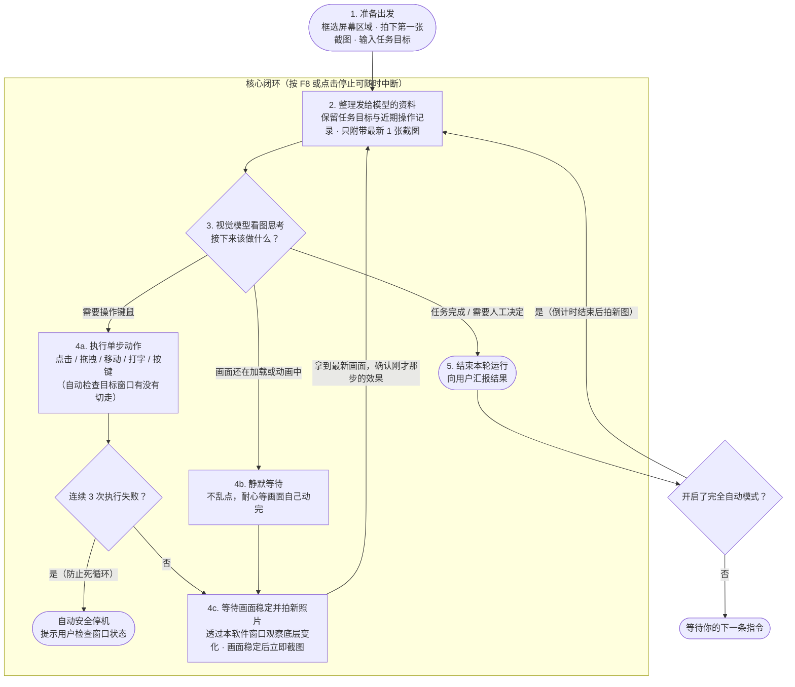

<div align="center">

# VLM_Screenshot_Action

[](./LICENSE)
[](https://www.microsoft.com/windows)
[](https://tauri.app)

**简体中文** | [English](./README.en.md)

### 所见，即所控。

一个运行在 Windows 上的视觉闭环参考实现。<br/>
不读取内存，不注入进程，不绑定特定游戏。<br/>
只用屏幕画面、模型推理与受控的原生输入，完成从观察到行动的完整循环。

[获取最新版本 (Releases)](https://github.com/s11IM/VLM_Screenshot_Action/releases) · [架构设计](./docs/architecture.md) · [验证标准](./docs/validation.md) · [贡献指南](./CONTRIBUTING.md) · [安全边界](./SECURITY.md)

</div>

---

## 为什么重新设计视觉控制环

让视觉模型操作桌面并不难；难的是让它在连续多步中保持清醒、准确，且随时可控。

常见的脚本往往卡在四个问题上：历史截图不断堆积导致模型把旧画面当成新状态；固定延时等待要么浪费时间、要么截在动画半途；应用自身的窗口遮挡了目标画面；焦点意外切换后键盘仍在盲打。

**VLM_Screenshot_Action** 将整个控制环收敛为四个清晰阶段：**观察（Observe）— 决策（Decide）— 执行（Act）— 核验（Verify）**。每一次操作都不默认成功，必须由下一张真实截图来确认结果。

---

## 核心设计

### 1. 只看当下，同时记住来路
**单帧锚定与投影式上下文。**  
完整的对话与截图历史保存在本地 IndexedDB 中，图文分离存储，互不阻塞。但在构建模型请求时，系统只投影最近数个循环（默认 `3` 个），自动召回当前活跃任务 `[ACTIVE_TASK]` 与上一轮总结 `[LAST_ROUND_SUMMARY]`，并将历史截图全部剥离，**永远只保留最后 1 张实截画面作为 `CURRENT_FRAME`**。
* 消除多图混淆与过期坐标干扰
* 用户上传的参考图标记为 `REFERENCE_IMAGE`，绝不混入可操作帧
* 大幅降低多轮长任务的 Token 与带宽开销

### 2. 看得见变化，也等得及稳定
**自适应画面趋稳检测。**  
动作发出后，系统不再机械等待固定秒数。内置的 `adaptive-window-v4` 采样器在 `320px` 灰度网格上持续追踪全局均值、局部峰值块与活跃像素比例：
* **提前唤醒（Early Wake）**：当画面发生有效变化并在 `1.8s` 滚动窗口内重新趋于稳定，立即结束等待并返回新截图。
* **时间预算守恒**：若提前唤醒后模型判断仍需调用 `wait`，系统只会继续消耗上一轮剩余的等待预算，不会无限延长回合寿命。
* **穿透自身采样**：在 Windows 10 2004+ 上通过 `WDA_EXCLUDEFROMCAPTURE` 将应用自身从采样画面中剔除。即使悬浮窗直接叠在目标区域上方，也不会遮挡视线或误触发画面变化；最终定格截图前再自动隐去窗口，确保画面纯净。

### 3. 直觉坐标，还原真实手感
**0–1000 归一化空间与原生输入。**  
模型无需计算屏幕分辨率。所有空间定位统一使用框选区域内的 `0..1000` 整数坐标，由 Rust 核心层按 Per-Monitor DPI V2 与 Windows 虚拟桌面（`VIRTUALDESK`）精确映射至物理像素，原生支持多显示器与负坐标副屏。
* **闭环视觉标记**：每次点击或拖拽后，下一张截图会自动绘入红十字或轨迹箭头，帮助模型直观校准落点，同时在提示词契约中明确区分“指令落点”与“实际响应”。
* **拟真时序与防漂移**：单击保持 `60ms` 按压；拖拽包含悬停、拾取、平滑移动与终点驻留。落点前自动回读硬件光标位置，超过 `2px` 偏差允许单次本地微调，且绝不重复派发已执行的点击。
* **上游协议兼容**：当模型意外返回原生 `computer` 工具调用时，内置适配器可将其帧像素坐标安全转换至 `0..1000` 原语，对不安全动作直接拦截。

### 4. 边界清晰，随时可以松手
**四重执行护栏。**  
自动化只有在可控的前提下才有意义：
* **空间约束**：鼠标动作严格限制在用户框选的单显示器矩形区域内。
* **焦点令牌锁（Frame Token Gate）**：键盘输入必须携带最新截图签发的单次 `frameId`，同时校验区域一致性、`5` 分钟时效与前台窗口句柄（HWND）。一旦中途切出窗口，键盘输入立即中断并逆序释放所有已按下按键。
* **F8 急停**：在键盘执行与等待画面稳定期间，底层持续轮询 `F8` 物理按键状态；前端停止按钮则通过原子标志位（`AtomicBool`）随时中断网络请求或动作序列。
* **连续失败熔断**：单次动作失败会自动重截画面尝试自愈；连续 `3` 次无法执行则直接终止本轮运行，避免无意义的死循环。

### 5. 单回合闭环，或全自动值守
**两套独立的观察节奏。**  
* **动作后自动观察**：每次执行 `click`、`drag`、`hover`、`keyboard_type`、`keyboard_press` 或 `wait` 后，自动等待画面稳定并进入下一轮推理，直到模型调用 `end_round` 或直接给出正式回复。
* **完全自动模式**：正式回复结束后，可按设定间隔（默认 `15s`）自动截取新画面并开启下一轮运行。配合一键切换的**小窗模式（Mini Mode）**，安静停靠在屏幕一角。

---

## 控制流一览

用一句话概括它的运行逻辑：**每做一步动作，都要等画面稳定后再拍一张新照片，看清楚上一步有没有生效，再决定下一步怎么做。**



### 内置动作原语

| 原语 | 作用 | 坐标 / 约束 |
| :--- | :--- | :--- |
| `click` | 左键单击或双击 | `x, y ∈ [0, 1000]`，`clicks ∈ {1, 2}` |
| `drag` | 按住左键从起点拖至终点 | `fromX, fromY, toX, toY ∈ [0, 1000]` |
| `hover` | 移动光标但不点击 | `x, y ∈ [0, 1000]` |
| `keyboard_type` | 输入字面 Unicode 文本（含中文） | 需 `frameId` 与前台焦点一致；不使用剪贴板 |
| `keyboard_press` | 按下单个按键或组合键并保持 | 1–8 个按键（如 `CTRL`、`ENTER`、`WASD`）；禁用 `F8` |
| `wait` | 不执行输入，等待画面变化并趋稳 | 无需指定时长，由采样器或剩余预算决定 |
| `end_round` | 主动结束当前运行并输出总结 | 目标完成、需人工决策或长时间无需操作时调用 |

---

## 快速开始

### 直接使用（Windows 10 / 11 x64）

1. **获取应用**：从 [GitHub Releases](https://github.com/s11IM/VLM_Screenshot_Action/releases) 下载 `VLM_Screenshot_Action-Portable-x64.zip` 解压运行 `start.cmd`，或运行 `VLM_Screenshot_Action-Setup-x64.exe` 安装（若在源码目录，可直接双击 `clickstart.cmd` 自动按需构建并启动）。
2. **连接模型**：打开右上角**设置页**，填入兼容 OpenAI `/chat/completions` 的接口地址、API Key 与支持视觉及工具调用的模型名称。
3. **框选并运行**：点击底部**选择截图范围**框选目标窗口区域，点击**手动截图**获取初始画面，输入目标后点击**发送**。

### 从源码构建与验证

环境要求：Windows 10/11 x64、Node.js `^24.12.0`、Rust stable (MSVC) 工具链、Visual Studio 2022 C++ Build Tools 与 WebView2 Runtime。

```powershell
# 安装依赖
npm ci

# 运行类型检查、前端单元测试与 Rust 格式检查
npm run check
npm run fmt:rust:check

# 运行 desktop-core 与 src-tauri 单元测试
npm run test:rust

# 启动桌面开发模式
npm run tauri -- dev

# 构建可公开发布的纯净安装包与便携包（自动拒绝打包个人配置与历史记录）
npm run package:public
```

---

## 边界与非目标

为了保持核心机制的清晰与可靠，本项目有意划定了以下边界：

* **不是安全沙箱或无人值守外挂**：屏幕内容可能包含提示词注入，模型判断亦可能出错。请在非敏感桌面与测试账号下使用，并全程保持人工监督。
* **不包含模型权重与游戏内存读取**：所有推理均通过您配置的外部 API 完成；应用仅通过像素画面理解状态。
* **无全局费用与步数硬上限**：单次网络请求受超时与单次重试约束，但整个回合在完成或被中断前会持续运行。
* **专注 Windows 桌面**：底层依赖 Win32 输入、DPI 感知与窗口显示亲和性 API，不提供 macOS、Linux 或移动端构建。

更多细节请参阅 [架构说明](./docs/architecture.md)、[验证清单](./docs/validation.md)、[贡献指南](./CONTRIBUTING.md) 与 [安全策略](./SECURITY.md)。

---

## 许可证

基于 [MIT License](./LICENSE) 开源。
