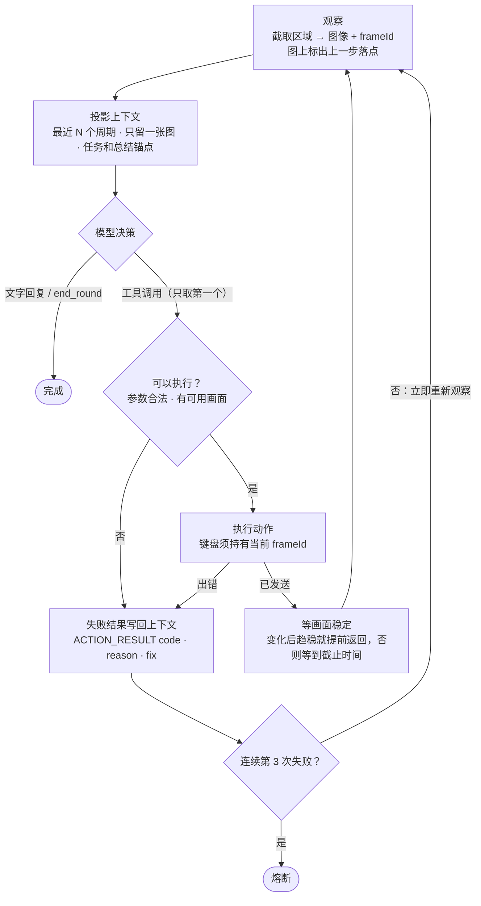

# VLM_Screenshot_Action

[](LICENSE)
[](https://www.microsoft.com/windows)
[](https://tauri.app)
[](https://github.com/s11IM/VLM_Screenshot_Action/actions/workflows/ci.yml)

**中文** | [English](README.en.md)

只靠截图和键鼠，让视觉语言模型操作桌面程序的闭环控制参考实现。

仓库里是一个能运行的 Windows 桌面程序（Tauri + React + Rust），但它只是演示。真正想分享的是循环本身的设计：模型看到什么、动作怎么落地、怎么确认效果、什么时候停。这些设计不依赖 Tauri，也不依赖 Windows：纯逻辑部分可以直接搬进你自己的 agent，平台部分只需要实现四个接口。

---

## 核心循环



循环只有三个出口：模型给出最终回复（**完成**）、连续 3 次动作做不成（**熔断**）、用户在任意阶段按停（**取消**）。除此之外没有总步数上限，这是有意的取舍，见[局限](#局限)。

后文会用到的几个概念：

| 名称 | 含义 |
|------|------|
| 轮（round） | 用户的一次发送，可以包含很多次模型请求 |
| 周期（cycle） | 一张截图，加上模型基于它做的分析和动作结果；上下文按周期裁剪 |
| `frameId` | 原生层给每张截图发的令牌，键盘动作要凭它执行 |
| `operationId` | 一次运行的取消句柄 |

---

## 十个可复用的设计

每条按「问题 → 做法 → 代价」写，最后给出代码位置。

### 看：模型拿到什么

#### 1. 上下文是投影，不是历史

**问题**：截图很占 token。每张图都带上，费用和上下文都会随步数线性增长，旧画面还会把定位带偏。

**做法**：完整历史只存在本地，每次请求现场生成一个小视图：

- 只取最近 N 个周期（`contextCycles`，默认 3）
- 整个请求只保留最后一张图。更早的图删掉，标签换成 `[IMAGE frame=OMITTED]`；留下的那张标为 `CURRENT_FRAME`，提示词要求只用它定位
- 滚出窗口的关键信息用文本锚点补回：最近一条用户任务 → `[ACTIVE_TASK]`，这条任务之后最近的一次最终回复 → `[LAST_ROUND_SUMMARY]`
- 历史工具调用不按 assistant/tool 协议原样回放，而是压成文本：`[STRATEGY_ANALYSIS]`（第 2 条）和 `[ACTION_RESULT]`（第 9 条）

**代价**：模型没有远期视觉记忆，需要对比很久以前画面的任务不适合。

**代码**：`src/model.ts` 的 `buildMessages`、`expireOldImages`，都是纯函数。

#### 2. 每个动作都附带 analysis

**问题**：历史工具调用不回放以后，模型看不到自己前几步做了什么、为什么做，容易来回反复。

**做法**：每个工具的 schema 都有必填参数 `analysis`（≤1000 字符，写本步的依据）。它以 `[STRATEGY_ANALYSIS]` 的形式留在保留窗口里，模型靠它延续自己的思路；它也存进会话历史，方便事后回看。

**代价**：每一步多一段输出 token。缺了这个参数不会拒绝执行，程序会补一句默认文字。

**代码**：`src/model.ts` 的 `STRATEGY_ANALYSIS_PROPERTY`、`parseToolArguments`。

#### 3. 在截图上标出上一步落点

**问题**：纯视觉定位会漂，但模型不知道自己上一下实际落在哪儿。

**做法**：动作后的截图上，用红色十字标出上一次点击或悬停的位置，拖拽则画出起点到终点的箭头；键盘动作不画。标记和真实输入用同一个坐标换算。模型对比「想点的位置」和「十字的位置」，下一步自行修正。

**代价**：标记是按指令坐标画上去的，不是录下来的鼠标轨迹，也不能证明目标响应了，提示词里明确告诉了模型这一点。标记本身也会盖住一小块画面。

**代码**：`src-tauri/src/lib.rs` 的 `draw_region_markers`；`src/App.tsx` 的 `lastActionMarker`。

### 动：动作怎么落地

#### 4. 归一化坐标：模型只说 0–1000

**问题**：模型看到的是缩放过的图。像素坐标和屏幕分辨率、DPI、窗口大小绑在一起，换一台机器就不对。

**做法**：所有工具参数都是相对截图区域的 0–1000 整数（左上 `0,0`，右下 `1000,1000`），直到执行前最后一步才换算成物理像素：

```text
screenX = region.x + round((region.width  - 1) * x / 1000)
screenY = region.y + round((region.height - 1) * y / 1000)
```

`1000` 落在最后一个像素上，不会越出区域。

**代价**：定位粒度是区域尺寸的千分之一；小按钮、低对比度控件能不能点准，仍取决于模型的视觉能力。

**代码**：`src/model.ts`（工具 schema）；`desktop-core/src/lib.rs` 的 `screen_point`。

#### 5. 一次观察只执行一个动作

**问题**：模型一次返回多个工具调用时，第二个动作依据的仍是第一个动作之前的画面，越往后越可能点空。

**做法**：请求里设置 `parallel_tool_calls: false`；服务端不遵守时，也只执行第一个调用，其余丢弃。每做完一个动作都重新观察。

**代价**：多步操作需要多次请求，延迟和费用随步数增加。

**代码**：`src/App.tsx` 的 `runModel`（`returnedToolCalls.slice(0, 1)`）。

#### 6. 没有画面，就不提供工具

**问题**：还没有可用截图时，模型给出的坐标只能是猜的。

**做法**：本轮已经有一张程序截取的画面，请求里才带工具；只框选了区域、只打字发送的第一轮，模型只能回文字。用户上传的参考图不算可用画面，也永远不会被标成 `CURRENT_FRAME`。模型如果仍然返回工具调用，按失败处理（第 9 条）。

**代价**：要动手，第一轮必须先截一张图。

**代码**：`src/model.ts` 的 `availableActionTools`、`latestRoundFrame`。

#### 7. 用 frameId 把动作绑定到画面

**问题**：模型依据画面 A 做的决定，执行时屏幕可能已经变成了 B：窗口被切走、焦点变了、截图是很久以前的。鼠标点错了，下一张图里看得出来；键盘打进了错误的窗口，可能造成实际损害。

**做法**：每次截图，原生层登记一个 `frameId`，同时记下区域和当时的前台窗口。键盘动作必须带上这个 `frameId`，并同时满足四个条件：是最新的一张、区域相同、不超过 5 分钟、前台窗口没变。校验通过后令牌立即作废，所以一张截图只授权一次键盘动作。输入过程中前台窗口一变，或者用户按下 F8，就立即中断，并按逆序松开已按下的键。

**代价**：每次键盘动作前都要有一张新截图。鼠标动作没有这道校验，只会让旧令牌作废。

**代码**：`src-tauri/src/lib.rs` 的 `CaptureState::take_keyboard_target`、`keyboard_should_stop`。

### 收：怎么确认，怎么停

#### 8. 等画面稳定，而不是固定等待

**问题**：动作之后等多久再截图？等短了截到动画中间，等长了白白浪费时间。固定 sleep 只能取一个折中值。

**做法**：动作后在本地持续采样低分辨率灰度图，和动作前模型看到的那张比较。画面「已经变化」并且「之后持续平稳」，就提前返回新截图；否则等到截止时间（默认 8 秒）。

- **保护期**：从收到模型输出起 4 秒内不允许提前返回。这段时间的采样用来估计画面本身的噪声，比如闪烁的光标、动态背景
- **确认窗口**：解锁后，要在至少 4 帧、跨度 1.8 秒的窗口内，变化都不超过噪声上限。比较的是整个窗口内每个像素的最大最小差，缓慢累积的变化也逃不掉
- **只有平稳的窗口能更新基线**：噪声基线只会被已经合格的窗口按 90% 旧值、10% 新值小幅更新，持续运动没法把自己「训练」成稳定
- **`wait` 不能给自己加时**：模型调用 `wait` 时不能指定时长；如果上一次是提前返回的，紧接着的 `wait` 只用剩下的时间

**代价**：画面稳定不等于语义上完成，静止的加载画面仍可能判断错。阈值是在游戏画面上调出来的，换场景可能要重调。

**代码**：`desktop-core/src/observe.rs` 的 `SettleDetector` 是纯状态机，输入灰度图和时间戳，输出是否触发，不碰任何平台 API；`src/observationTimer.ts` 负责保护期和 `wait` 续时。全部参数见 [docs/architecture.md](docs/architecture.md#two-observation-loops)。

#### 9. 失败也是一次观察

**问题**：参数不合法、工具没开、执行出错时，直接抛异常，整轮就断了；悄悄忽略，模型会一直重复同一个错误。

**做法**：所有失败都写成一条结构化文本交给模型，然后**立即**重新截图（不走稳定等待）再问一次：

```text
[ACTION_RESULT tool=click status=FAILED code=INVALID_TOOL_ARGUMENTS reason=… fix=…]
```

成功只写 `status=SUCCESS`。「输入已发送」不等于目标响应了，效果要看下一张图。

连续 3 次失败就熔断，主动结束本轮；中间只要成功一次就清零。这道闸只防「一直做不成」，不防「一直在做」。

**代价**：3 是经验值；原因各不相同的连续失败也会被一起截断。

**代码**：`src/App.tsx` 的 `actionResultContextText`；`src/toolFailureGuard.ts`。

#### 10. 取消必须传到每一层

**问题**：一个循环里同时有网络请求、键鼠输入、等待计时器。用户喊停时，只要有一处没停下，程序就可能继续动手。

**做法**：每次运行有一个 `operationId`。前端在每个关键 `await` 之后检查它是否仍是当前运行；原生层对应一个原子标志，HTTP 请求和它赛跑，输入和等待循环以 10 毫秒级的间隔检查它。取消后状态锁定，不会自动恢复；已按下的键按逆序松开，拖拽失败也会尝试松开鼠标。

**代价**：取消是协作式的，已经发出去的输入撤不回来。F8 只在键盘输入和画面观察期间有效，其他阶段要用界面上的停止按钮。

**代码**：`src-tauri/src/lib.rs` 的 `begin_operation`、`cancel_operation`；`desktop-core/src/lib.rs` 的 `check_cancel`、`wait`。

---

## 移植到你的项目

### 可以直接拿走

| 文件 | 内容 | 依赖 |
|------|------|------|
| `src/model.ts` | 工具 schema、上下文投影 `buildMessages`、单图保留 `expireOldImages`、参数校验 `parseToolArguments` | 只依赖 `src/types.ts` |
| `src/toolFailureGuard.ts` | 连续失败熔断 | 无 |
| `src/observationTimer.ts` | 保护期、`wait` 续时 | 只依赖类型 |
| `src/computerToolAdapter.ts` | 把模型意外返回的 Anthropic `computer` 工具调用安全映射成本项目的工具 | 只依赖类型 |
| `desktop-core/src/observe.rs` | 画面稳定检测 `SettleDetector` | 只在缩放时用到 `image` 的 `RgbaImage`（经 xcap 引入） |

提示词和工具描述是中文写的，面向游戏场景（`src/model.ts` 的 `SYSTEM_PROMPT`），搬走时按你的场景改写。

### 需要换成你的平台实现

| 能力 | 本项目的 Windows 实现 |
|------|------------------------|
| 截取区域 | xcap（`desktop-core` 的 `capture_region`） |
| 鼠标和键盘 | 移动用 `SendInput` 虚拟桌面绝对坐标（支持多显示器和负坐标），按键和按钮用 enigo |
| 前台窗口（键盘令牌用） | Win32 `GetForegroundWindow` |
| 检测期间不拍到自己 | `WDA_EXCLUDEFROMCAPTURE`，系统不支持时退回隐藏窗口 |
| 模型请求 | Rust 侧 reqwest 转发，可取消、有超时，接口为 OpenAI 兼容的 `/chat/completions` |

### 宿主需要提供的四个接口

对应本项目 `src/tauri.ts` 里的 `captureRegion`、`executeInputAction`、`observeRegion`、`cancelOperation`：

```ts
interface DesktopHost {
  // 截图，并在原生层登记 frameId、区域和当时的前台窗口
  capture(region: Region): Promise<{ image: string; frameId: string }>;
  // 执行一个动作；键盘动作在这里校验并作废 frameId
  execute(region: Region, action: Action, frameId?: string): Promise<void>;
  // 动作后的观察：本地判断画面是否稳定，返回新截图和是否提前醒来
  observe(region: Region, opts: { deadlineMs: number; probeDelayMs: number }): Promise<{
    image: string;
    frameId: string;
    outcome: "early_wake" | "deadline";
    waitedMs: number;
  }>;
  // 取消：设置原子标志，每个阻塞点都要检查它
  cancel(operationId: string): Promise<void>;
}
```

### 移植时别丢的约束

- 只有最新一张程序截图可以作为定位依据
- 每次模型回复最多执行一个动作
- 键盘动作必须持有当前、同区域、同前台窗口的 `frameId`，用完作废
- 失败要回给模型并立即重新观察；连续失败要有上限
- 「输入已发送」不等于成功，效果只看下一张图
- 稳定检测不能延长截止时间，`wait` 不能给自己加时
- 取消后状态锁定，已按下的键必须松开

这些约束大多有对应的单元测试，对照表见 [docs/validation.md](docs/validation.md)。

---

## Demo：Windows 桌面程序

框选一块屏幕区域，写下任务，模型就按上面的循环截图、操作、再截图，直到完成或你按停。适合没有 API 可用的程序，比如游戏、模拟器、老软件。

**下载**：[Releases](https://github.com/s11IM/VLM_Screenshot_Action/releases) 提供安装包和便携版。

**从源码构建**（Windows 10/11、Node.js ≥ 24.12、Rust 稳定版和 VS C++ 构建工具，详见 [CONTRIBUTING.md](CONTRIBUTING.md)）：

```bash
git clone https://github.com/s11IM/VLM_Screenshot_Action.git
cd VLM_Screenshot_Action
npm ci
npm run tauri dev     # 开发调试
npm run tauri build   # 安装包输出到 src-tauri/target/release/bundle/
```

**使用**：

1. 右上角齿轮进入设置，填写 API URL、API Key 和模型名。任意 OpenAI 兼容接口都可以，模型需要支持视觉和 function calling
2. 点「选择截图范围」，在屏幕遮罩上拖动框选目标窗口，Esc 取消
3. 点「手动截图」拿到第一张画面（第 6 条），写下任务后发送
4. 随时可以按停止按钮中断；要长时间挂机，点「启用完全自动」并切到迷你模式

核心循环之外，Demo 还有两个开关：

- **工具后自动截图**（默认开）：关掉后，每次动作执行完就停下，等你手动截图驱动下一步；`wait` 除外
- **完全自动**（默认关）：一轮以最终回复结束后，隔一段时间自动截图，开始新的一轮；`end_round` 不会关掉它，熔断结束的轮次不会自动续上

### 工具集

| 工具 | 用途 | 关键参数 |
|------|------|----------|
| `click` | 单击 / 双击 | `x, y`（0–1000），`clicks: 1\|2` |
| `drag` | 拖拽 | `fromX, fromY, toX, toY` |
| `hover` | 悬停（等待 tooltip） | `x, y` |
| `keyboard_type` | 输入字面 Unicode 文本 | `text`（≤10000 字符），`intervalMs`，`submit` |
| `keyboard_press` | 物理按键 / 组合键 | `keys[]`（1–8 个），`holdMs` |
| `wait` | 等待画面变化 | 无（不能指定时长） |
| `end_round` | 结束本轮 | `message`（给用户的总结） |

每个工具都要求附带 `analysis`（第 2 条）。部分模型经兼容网关时会返回 Anthropic 风格的 `computer` 工具调用，适配器把截图像素坐标换算成 0–1000 后映射到上表：`screenshot→wait`、`left_click/double_click→click`、`mouse_move→hover`、`left_click_drag→drag`、`type→keyboard_type`、`key→keyboard_press`；无法安全映射的动作直接拒绝。

### 配置项

| 配置 | 默认值 | 范围 / 说明 |
|------|--------|-------------|
| API URL | `https://api.openai.com/v1` | 任意 OpenAI 兼容接口 |
| 模型 | `gpt-4o-mini` | 需支持视觉与 function calling |
| Reasoning Effort | `low` | `low` / `high` / `xhigh`，始终发送，不是所有接口都支持 |
| 上下文循环数 | `3` | 1–999，即第 1 条的 N |
| 动作后等待时间 | `8` 秒 | 0.5–120 秒，即第 8 条的截止时间 |
| 提前探测 | 开 | 关闭后退回固定等待 |
| 完全自动间隔 | `15` 秒 | 5–120 秒 |
| 请求超时 | `60` 秒 | 5–300 秒 |
| 失败重试 | 开，间隔 3 秒 | 0–15 秒，最多重试一次 |
| 提供模型工具 | 开 | 关闭后只能纯对话 |
| 工具后自动截图 | 开 | 见上文 |

运行日志位于系统应用日志目录下的 `vlm_screenshot_action.log`，按字段名脱敏，分享前仍需自行检查（见 [SECURITY.md](SECURITY.md)）。

---

## 局限

1. 只支持 Windows。控制循环写在 React 前端里，不是后台服务；关闭程序就停止，历史记录不会恢复运行
2. 没有总步数、总时长、总费用上限，也没有人工审批环节；熔断只防「一直做不成」
3. 屏幕内容和模型输出都不可信。工具校验只限制参数格式，不判断动作是否合适，屏幕上的文字可能构成提示注入
4. 无法操作以更高权限（UAC）运行的程序；独占全屏游戏建议改为窗口化或无边框
5. 截图区域必须完整位于同一块显示器内（多显示器和混合 DPI 已适配）
6. `keyboard_type` 逐字符发送，不适合超长文本的高速录入

## 延伸阅读

- [docs/architecture.md](docs/architecture.md)：时序图、ID 与生命周期，以及稳定检测和输入时序的全部参数
- [docs/validation.md](docs/validation.md)：每条约束对应哪个测试，以及手动桌面测试的运行方法
- [SECURITY.md](SECURITY.md)：数据流向、密钥存储和日志脱敏的边界
- [CONTRIBUTING.md](CONTRIBUTING.md)：开发环境和提交约定

## 许可证

[MIT](LICENSE)
